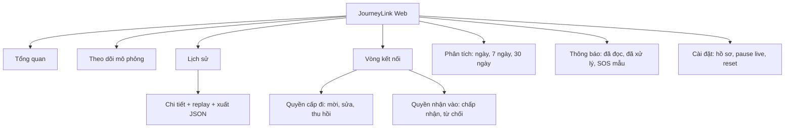

# Phân tích JourneyLink

## 1. Cơ sở và yêu cầu

Đề tài: Hệ thống giám sát, lưu trữ và chia sẻ hành trình dựa trên GPS. Phạm vi người dùng yêu cầu hiện tại là **Web App**, chuẩn bị cấu trúc tích hợp Mobile sau này. ReactJS, ES6+, HTML5, CSS3 bắt buộc; backend nhẹ hoặc không có, cho phép JSON/localStorage và mô phỏng GPS.

Tài liệu gốc có trong thư mục cha. Đã tạo danh mục 26 nguồn PDF/DOCX, trong đó 24 nội dung khác nhau và 2 bản trùng hash; bản text theo trang ở `research/`. Slide mở đầu chỉ có hình ảnh, đã render để kiểm tra trực quan (`start-contact.png`). Việc có một nội dung trong đề cương không chứng minh sinh viên đã học xong nội dung đó; phần React/Hook được xác định từ đề cương và bài mẫu React hiện có.

**Thông tin còn thiếu:** rubric cụ thể của đề tài GPS, hạn nộp, số thành viên, số trang báo cáo, yêu cầu triển khai Internet/Node backend riêng, và xác nhận của giảng viên về phạm vi chỉ Web. Slide mở đầu trang 3 đề cập một hướng BTL khác về trao đổi đa phương tiện Web–Mobile/WebRTC; không áp đặt hướng đó vào đề tài GPS người dùng đã chọn. Không khẳng định bản Web này đáp ứng trọn các CLO Mobile.

## 2. Nghiên cứu sản phẩm tham khảo

Google Maps tổ chức chia sẻ theo người nhận, thời hạn và khả năng dừng chia sẻ; phần chia sẻ tiến trình chuyến đi gắn với một hành trình. Tham khảo [trợ giúp Google Maps](https://support.google.com/maps/answer/15437054?co=GENIE.Platform%3DAndroid&hl=en).

Life360 dùng Circle để gom những người chia sẻ vị trí, với quyền chia sẻ riêng cho vòng. Tham khảo [Location Sharing & Privacy](https://support.life360.com/hc/en-us/articles/23053679126551-Life360-Location-Sharing-Privacy), [Share My Location](https://support.life360.com/hc/en-us/articles/23053695148823-Share-My-Location). Những đặc tính này là tham khảo tổ chức UX, không sao chép dịch vụ hay tuyên bố JourneyLink có cùng năng lực. Ngày tra cứu: 12/11/2026.

### Các hướng đề xuất

| Mô hình | Giá trị / điểm khác biệt | Hạn chế | Khả thi với Web demo |
|---|---|---|---|
| Journey Live | Nhiều người trên bản đồ, giúp biết người thân đang ở đâu | Phụ thuộc nguồn GPS; dễ nhầm realtime nếu không ghi rõ | Cao với mô phỏng, thấp hơn nếu cần GPS nền thật |
| Journey Journal | Timeline + phát lại chuyến đi theo timestamp | Ít hữu ích cho tình huống đang di chuyển | Cao, dữ liệu mẫu tái lập được |
| Journey Circle | Chia sẻ có thời hạn, tách trực tiếp/lịch sử, trải nghiệm hai phía | Cần làm rõ hướng quyền và trạng thái mời | Cao, minh họa tốt nghiệp vụ và state |
| Safety Monitor | SOS, đến nơi, vùng địa lý | Cần GPS đáng tin cậy và delivery cảnh báo; vượt demo frontend | Chỉ phù hợp phần sự kiện mô phỏng |

**Lựa chọn:** Journey Circle làm trục nghiệp vụ, Journey Live là trang theo dõi và Journey Replay làm điểm nhấn. Analytics được dẫn xuất từ cùng dữ liệu; không thêm CRUD xe/tài xế. Khác biệt của bản đồ án nằm ở trải nghiệm “biết ai đang xem gì” và kiểm chứng ngay từ hồ sơ người nhận, kết hợp replay theo thời gian. Đây là lựa chọn thiết kế cho bài tập, không phải tuyên bố tính năng độc quyền thị trường.

## 3. Người dùng và tình huống

Một tài khoản có thể đồng thời đóng vai chủ hành trình, người cấp quyền và người nhận quyền. Vòng Gia đình/Bạn bè phân loại hồ sơ mẫu; thành viên cùng vòng **không tự động** có quyền xem tọa độ.

Tình huống: Trường cho Linh xem lịch sử trong một giờ. Lời mời ở trạng thái pending, Linh chưa được truy cập. Linh chấp nhận → được xem tuyến và replay. Trường bỏ quyền lịch sử hoặc thu hồi → danh sách, trang chi tiết và analytics của Linh đều không cung cấp các hành trình này. Quyền Linh cấp ngược lại cho Trường hoàn toàn độc lập.

### Quy tắc nghiệp vụ

1. Chủ sở hữu luôn xem được dữ liệu của mình trong demo.
2. Người khác cần một grant `accepted`, chưa hết hạn và có đúng quyền `live` hoặc `history`.
3. `expiresAt <= now` là hết hiệu lực, không chờ reload. Đồng hồ Store cập nhật mỗi giây; quyền chỉ minh họa trong bộ nhớ client.
4. Mời chưa được chấp nhận, từ chối hoặc thu hồi đều không cấp quyền.
5. Chỉ UI của chủ quyền cho phép chỉnh phạm vi/thu hồi. Người nhận chấp nhận hoặc từ chối lời mời gửi cho mình.
6. Tạm dừng chia sẻ của một hồ sơ ngăn người khác xem trực tiếp; không thu hồi lịch sử.
7. Lịch sử/chi tiết/replay/analytics dùng cùng hàm kiểm tra quyền; biết ID không bỏ qua bộ lọc UI.
8. Quyền xem trực tiếp chưa cho phép xem toàn bộ tuyến dự kiến; bản đồ live chỉ vẽ phần đã mô phỏng đi qua.
9. Dữ liệu lịch sử là `sample`, live là `simulated`. Không gắn nhãn nhận GPS thật.

## 4. Phạm vi theo ưu tiên

Thang giá trị/sáng tạo/độ khó 1 thấp → 5 cao. Đây là đánh giá thiết kế nội bộ, không phải thang điểm giảng viên.

| Chức năng | Giá trị | Sáng tạo | Khó | Mức | Kết quả |
|---|---:|---:|---:|---|---|
| Dashboard liên kết dữ liệu | 4 | 2 | 2 | Cốt lõi | Có |
| Bản đồ thật, nhiều marker, trạng thái và route | 5 | 4 | 3 | Cốt lõi | Có, GPS mô phỏng |
| Lịch sử, từ khóa/người/ngày, chi tiết | 5 | 3 | 2 | Cốt lõi | Có |
| Replay: play/pause/tốc độ/seek | 4 | 5 | 3 | Cốt lõi | Có, dựa timestamp |
| Grant trực tiếp/lịch sử, thời hạn, thu hồi | 5 | 4 | 3 | Cốt lõi | Có, localStorage |
| Mời và chấp nhận theo hai hồ sơ | 4 | 4 | 3 | Bổ trợ | Có trong dữ liệu demo |
| Analytics và so kỳ trước | 3 | 3 | 2 | Bổ trợ | Có |
| Thông báo, đã đọc, đã xử lý, SOS mẫu | 3 | 2 | 2 | Bổ trợ | Có |
| Đổi tên, pause live, reset | 3 | 2 | 2 | Bổ trợ | Có |
| Quản trị nhóm tùy ý, địa điểm yêu thích | 2 | 2 | 3 | Nâng cao | Chưa làm |
| Geofence, arrival tự động, SOS delivery | 4 | 4 | 5 | Nâng cao | Chưa làm |
| Auth thật, Mobile thu GPS, WebSocket | 5 | 3 | 5 | Ngoài phạm vi | Chưa làm |

## 5. Thiết kế trải nghiệm

Sidebar cố định trên desktop; menu trượt trên browser di động. Header gồm breadcrumb, nhãn demo, ngày Việt Nam, thông báo và hồ sơ. Tông xanh lá dịu, nền ngà, typography Be Vietnam Pro có fallback, avatar chữ để không phụ thuộc ảnh ngoài. Bản đồ ở trung tâm; danh sách người và tóm tắt tuyến cung cấp ngữ cảnh thay vì chỉ số trang trí.

Trang lịch sử có bộ lọc và empty state; detail có tuyến/điểm đầu-cuối/điểm dừng và thanh thời gian. Grant cấp đi và grant nhận vào nằm hai vùng có giải thích rõ hướng quyền. Hồ sơ demo nằm trong Cài đặt để phục vụ bảo vệ; không dựng form đăng nhập giả.

Loading khi repository đọc dữ liệu, lỗi schema có khôi phục dữ liệu mẫu, tile lỗi có thử lại, kết quả rỗng có giải thích. Các control có label, nút focus-visible, skip link, điều hướng bằng link và marker hỗ trợ bàn phím. Chưa kiểm toán WCAG đầy đủ.

## 6. Sơ đồ chức năng

## 7. Tiêu chí nghiệm thu nội bộ

Ứng dụng build được; các route mở trực tiếp và qua sidebar; bản đồ tương tác; marker chọn được; mô phỏng tạm dừng được; tìm/lọc thay đổi danh sách; replay theo thời gian; grant có hiệu lực đúng chiều và hết hạn; dữ liệu lưu qua reload; thống kê trùng dữ liệu tọa độ; thông báo cập nhật trạng thái; responsive và empty/error state. Kết quả chạy được ghi riêng trong `TEST-RESULTS.md`.
