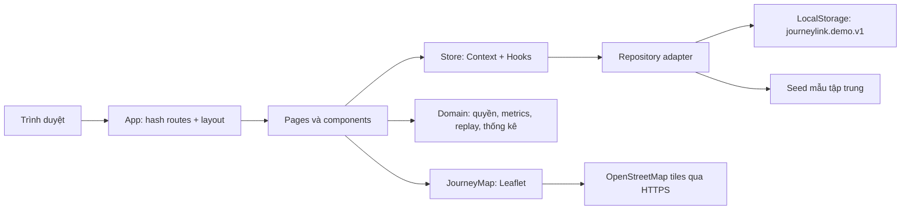
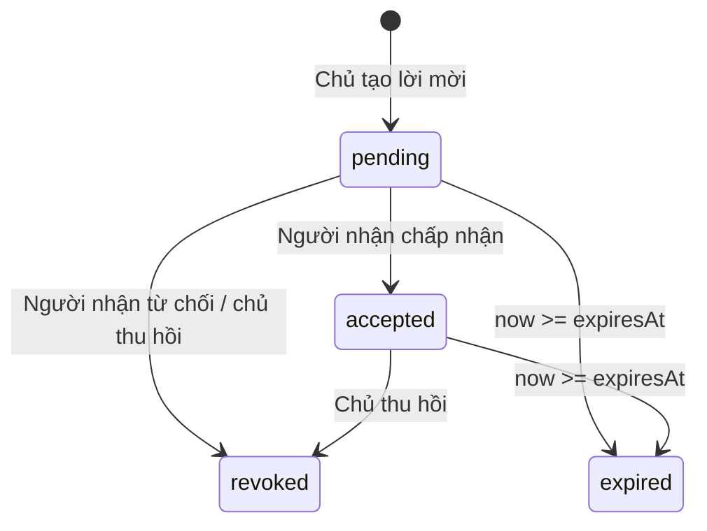

# Kiến trúc và dữ liệu

## Kiến trúc hiện tại



Node.js chỉ chạy Vite và kiểm thử/build. Không có endpoint GPS hay server nghiệp vụ. `repository.load()` là Promise để UI có bước loading/error; `save()` hiện đồng bộ localStorage. Khi chuyển sang HTTP, phải đổi thao tác ghi sang async và chỉ thông báo thành công sau khi nhận response; không chỉ thay URL và giữ nguyên semantics đồng bộ.

`Store` sở hữu bộ dữ liệu, hồ sơ hiện hành, đồng hồ mỗi giây và hàm cập nhật. Các hàm thuần trong `domain.js` xử lý nghiệp vụ; mọi trang lấy dữ liệu từ cùng Store. `App` quản lý hash và menu; `History` mở detail theo ID. Không dùng một file chứa toàn bộ ứng dụng.

`JourneyMap` tạo Leaflet instance qua ref, resize bằng ResizeObserver, giữ marker theo user ID, vẽ polyline và điểm dừng, hủy observer/map khi unmount. Chọn tuyến/thay người thì fitBounds; đồng hồ chạy không ép pan/zoom về ban đầu. Control “Hiển thị toàn bộ tuyến” fit cả tọa độ route và những người hiện có; control định vị về người đang chọn. Marker popup tạo qua DOM textContent, không đưa tên người dùng vào HTML chưa escape.

## Luồng chia sẻ

Chia sẻ lịch sử có `kind: 'history'`, luôn `live: false`, `history: true`; `journeyIds` tùy chọn giới hạn các chuyến hoàn thành thuộc chủ sở hữu. Không có `journeyIds` nghĩa là toàn bộ lịch sử. `addHistoryShare` kiểm tra chủ sở hữu, người nhận, thời hạn, phạm vi và lời mời trùng. Repository kiểm tra liên kết chuyến khi tải dữ liệu. `hasAccess` nhận thêm ID chuyến; danh sách, chi tiết và thống kê dùng chung phép kiểm tra này. Grant cũ giữ nguyên; các quyền được cộng gộp. [Luồng trình diễn](HISTORY-SHARING.md).



`expired` là trạng thái suy ra theo thời gian; không ghi chuỗi này vào trường status. Thu hồi chấm dứt một grant; muốn cấp lại tạo lời mời mới. Quyền live/history của grant đang còn hạn có thể thay đổi; nếu bỏ cả hai checkbox, grant không cấp năng lực truy cập nào. Một lời mời mới phải có ít nhất một quyền. Không tự chấp nhận lời mời. Thành viên cùng vòng không thay thế grant.

## Mô hình dữ liệu

Tất cả timestamp là **Unix milliseconds**, hiển thị theo `Asia/Ho_Chi_Minh`. Bản demo không có tọa độ, email hoặc tài khoản người thật; email dùng miền `.test`.

| Collection | Trường chính | Ý nghĩa |
|---|---|---|
| users | id, name, initials, color, circle, email, pauseLive | Hồ sơ mẫu, trạng thái ngừng chia sẻ live |
| journeys | id, ownerId, title, from, to, startedAt, endedAt?, status, source, points, stops | Chuyến đi và tọa độ |
| grants | id, ownerId, viewerId, live, liveJourneyIds?, history, journeyIds?, kind?, status, expiresAt | Quyền **owner → viewer**, vị trí và phạm vi chuyến riêng |
| circles | id, name, description | Hai vòng mẫu để phân loại và lọc |
| notifications | id, recipientId, ownerId, type, title, body, createdAt, read, resolved | Sự kiện/nhật ký cục bộ |

Các trường cấp root: `version:1`, `activeUserId`, `seededAt`. `initials` là chữ viết tắt mẫu cố định, không tự đổi khi sửa tên. `circle` trong bản này là một nhãn cho mỗi hồ sơ, không phải quan hệ nhiều-nhiều của hệ thống nhóm thật.

`live` chỉ cấp vị trí GPS hiện tại. `liveJourneyIds` chỉ định chính xác chuyến đang diễn ra được phép hiện tuyến; mặc định rỗng hoặc không có. `liveView` kiểm tra quyền, thời hạn và pause theo thời gian thực rồi bỏ toàn bộ title/from/to/points/trail/stops/progress/traveled khỏi dữ liệu đưa vào UI khi chỉ được chia sẻ vị trí. Tuyến live chỉ vẽ phần đã đi của chuyến được chia sẻ. Khi chuyến hoàn thành, quyền live không thay thế quyền xem lịch sử. Tắt live đồng thời xóa phạm vi hành trình trong giao diện quản lý.

Ví dụ rút gọn (không phải điểm dữ liệu duy nhất):

```json
{
  "id": "trip-example",
  "ownerId": "truong",
  "title": "Hành trình buổi sáng",
  "from": "Đại học Bách khoa Hà Nội",
  "to": "Hồ Hoàn Kiếm",
  "status": "completed",
  "source": "sample",
  "startedAt": 1794443400000,
  "endedAt": 1794444600000,
  "points": [
    { "lat": 21.0048, "lng": 105.8431, "timestamp": 1794443400000 },
    { "lat": 21.0285, "lng": 105.8543, "timestamp": 1794444600000 }
  ],
  "stops": []
}
```

Ba tuyến phố Hà Nội lấy hình học đầy đủ từ OSRM/OpenStreetMap, đóng gói trong `src/data/road-routes.json`; không gọi dịch vụ định tuyến lúc chạy app. `journeyGeometry.js` giữ tất cả đỉnh góc rẽ, chia nhỏ mỗi đoạn đường tối đa 12 m và phân phối timestamp theo quãng đường. Lịch sử có một điểm dừng 60 giây, live dùng cùng hình học đường phố. 18 ngày lịch sử có nhịp xuất hiện khác nhau theo người. Snapshot live chỉ dẫn xuất trong bộ nhớ, không ghi tọa độ mỗi giây vào localStorage. Refresh dùng `seededAt` để tiếp tục mô phỏng theo đồng hồ thực; không phải trình ghi hành trình nền.

`geometryVersion: 2` và `routeId` gắn với từng hành trình mẫu. Repository tự chuyển fixture cũ sang geometry mới, giữ ID, tên chuyến, thời gian đầu/cuối, hồ sơ, grant và thông báo. Chỉ các chuyến sample/simulated nhận diện được mới chuyển; không tự thay GPS nguồn device. Script cập nhật geometry dành cho phát triển: `node scripts/fetch-road-routes.mjs`. Nguồn và tọa độ đầu/cuối sau snap được lưu kèm JSON. Điểm đầu/cuối trên đường truy cập gần địa điểm, không kéo một đoạn thẳng vào giữa công trình.

## Công thức và tính nhất quán

- Quãng đường: tổng Haversine giữa các điểm kế tiếp, bán kính Trái Đất 6371 km; không phải odometer hay road routing.
- Thời lượng: timestamp cuối trừ timestamp đầu. Tốc độ trung bình = tổng km / toàn bộ giờ, gồm dừng.
- Thời gian dừng: cộng thời gian giữa hai mẫu nếu tốc độ dưới 0,5 km/h. Không dùng ngưỡng khoảng cách đơn thuần vì dữ liệu bám đường có nhiều đoạn chuyển động ngắn. Đây là quy tắc demo đơn giản, không chống nhiễu GPS thực tế.
- Replay: tìm hai điểm kề thời điểm chọn, nội suy trên đoạn geometry đường phố theo tỷ lệ thời gian. Không bỏ qua góc rẽ và không nối thẳng giữa các waypoint thưa. Tọa độ lặp giữ marker đứng yên tại stop. Leaflet `smoothFactor: 0` giữ nguyên geometry khi vẽ cả nét nền và nét tuyến.
- Live: người đang di chuyển bắt đầu ở 25% route, tăng theo thời gian từ `seededAt`, tối đa 100%, sau đó trạng thái arrived. Người stopped đứng ở 50%; stale ở 33%, timestamp cập nhật giữ nguyên.
- Analytics: chỉ chuyến completed người xem có quyền history; nhóm theo ngày Việt Nam. Kỳ trước là khoảng cùng số ngày ngay trước kỳ hiện tại. Bổ sung ngày 0 để chart không thiếu ngày.
- Dashboard dùng cùng hàm quyền/metrics/aggregate. Số live dựa quyền live; tổng quãng đường dựa quyền history, nên hai tập này có thể khác nhau đúng nghiệp vụ.

## Adapter API tương lai — chưa triển khai

Giữ schema danh tính/quyền/timestamp, thay seed/localStorage bằng HTTP repository. Chỉ máy chủ được quyết định actor từ session/token; không tin `activeUserId`, `viewerId` do client cung cấp để phân quyền.

| Endpoint dự kiến | Hành vi | Mã điển hình |
|---|---|---|
| GET /api/me | Hồ sơ từ phiên xác thực | 200/401 |
| GET /api/live | Chỉ vị trí đang được chia sẻ với actor, chưa hết hạn | 200/401 |
| GET /api/journeys?from=&to=&q= | Lịch sử được phép, phân trang | 200/400/401 |
| GET /api/journeys/:id | Detail sau owner/history check | 200/401/403/404 |
| POST /api/grants | Chủ tạo lời mời cho người nhận | 201/400/401 |
| PATCH /api/grants/:id | Owner sửa phạm vi hoặc thu hồi | 200/401/403/404 |
| POST /api/grants/:id/accept | Viewer chấp nhận lời mời còn hạn | 200/401/403/409 |
| GET /api/notifications | Sự kiện chỉ của actor | 200/401 |
| PATCH /api/notifications/:id | Đánh dấu read/resolved đúng recipient | 200/401/403/404 |
| POST /api/journeys/:id/points | Mobile chủ hành trình gửi batch điểm | 201/400/401/403 |

Batch dự kiến `{ points: [{lat,lng,timestamp,accuracy,speed}], source:'device' }`. Server kiểm tra owner, tọa độ hữu hạn trong miền hợp lệ, thứ tự timestamp, kích thước batch, accuracy, chống gửi lại điểm và trạng thái chuyến đi. Khi có thật cần lưu thiết bị/độ chính xác, xử lý offline và độ trễ. Polling đơn giản đủ cho phiên bản API đầu, chưa cần WebSocket.

Thu hồi quyền phải được thi hành server ngay ở mọi endpoint, kể cả export, replay và live. Client xóa cache của dữ liệu bị thu hồi. SOS production cần đường truyền/delivery và xác nhận riêng; không dùng thông báo cục bộ để thay dịch vụ khẩn cấp.

## Ràng buộc vận hành

LocalStorage chỉ phù hợp dữ liệu giả, không mã hóa và người dùng có thể sửa. Có kiểm tra schema ban đầu và fallback khi JSON không hợp lệ; nếu trình duyệt chặn/quá quota thì hiện lỗi lưu. Không đảm bảo đồng bộ nhiều tab. Build chứa toàn bộ sample data nên không dùng cơ chế lọc client này làm bảo mật sản phẩm thật.

OpenStreetMap tiles gọi trực tiếp có attribution, không prefetch/bulk download. Tải bản đồ cần Internet, không có tile cache offline. Google Fonts có fallback hệ thống. Không cần giữ secret hoặc API key trong project.
